# Segundo cérebro: IA generativa no desenvolvimento de software

> Projeto desenvolvido para o desafio de criação de um segundo cérebro com IA no Gemini Notebook (NotebookLM), da DIO.

## Tema e objetivo

**Tema:** IA generativa aplicada ao desenvolvimento de software.

**Objetivo:** criar um assistente de estudos capaz de explicar como a IA generativa pode apoiar o desenvolvimento de software, apresentar benefícios, limitações e riscos, e recomendar práticas responsáveis com base apenas em fontes confiáveis selecionadas.

## Fontes selecionadas

Foram escolhidas fontes institucionais em formatos diferentes para equilibrar fundamentos, aplicação prática, evidências de produtividade e análise de riscos.

| Fonte | Formato | Por que é confiável |
| --- | --- | --- |
| [What is Machine Learning?](https://developers.google.com/machine-learning/intro-to-ml/what-is-ml) — Google for Developers | Artigo/documentação | Material educacional oficial do Google que apresenta os fundamentos de aprendizado de máquina e IA generativa. |
| [How to elevate software development with AI-assisted coding](https://www.youtube.com/watch?v=S2GqQ4gJAH0) — Google for Developers | Vídeo | Palestra publicada pelo canal oficial Google for Developers, com exemplos de uso de IA no ciclo de desenvolvimento. |
| [Research: How GitHub Copilot helps improve developer productivity](https://github.blog/news-insights/research/research-how-github-copilot-helps-improve-developer-productivity/) — GitHub | Artigo de pesquisa | Relata metodologia e resultados de uma pesquisa do GitHub com mais de 2.000 desenvolvedores; também permite discutir possíveis limitações por ser uma fonte do fornecedor. |
| [Artificial Intelligence Risk Management Framework: Generative Artificial Intelligence Profile](https://doi.org/10.6028/NIST.AI.600-1) — NIST | PDF técnico | Publicação oficial do NIST, instituto público de referência em padrões e gestão de riscos, dedicada aos riscos e controles de IA generativa. |

## Critérios usados para selecionar as fontes

- autoria e instituição identificáveis;
- conteúdo diretamente relacionado ao tema;
- presença de fundamentos, aplicações e riscos;
- formatos variados: artigo, vídeo e PDF;
- preferência por documentação oficial e pesquisa com metodologia descrita;
- ausência de dados pessoais ou conteúdo sem autorização para compartilhamento.

## Diretriz do notebook

> Atue como um especialista e professor de IA generativa aplicada ao desenvolvimento de software. Responda exclusivamente com base nas fontes deste notebook. Explique os conceitos de forma clara para uma pessoa iniciante em tecnologia, sem omitir detalhes importantes. Em cada resposta, apresente as citações correspondentes. Diferencie fatos apresentados pelas fontes, conclusões dos autores e inferências. Se as fontes não trouxerem informação suficiente, diga isso explicitamente. Ao tratar de produtividade, segurança ou qualidade, compare benefícios, limitações e riscos e não apresente alegações promocionais como consenso científico.

## Perguntas realizadas

As perguntas foram feitas mantendo quatro fontes selecionadas. As imagens abaixo registram as respostas e as citações apresentadas pelo Gemini Notebook.

### 1. O que é IA generativa e como ela se diferencia de outras formas de aprendizado de máquina?

**Resumo da resposta:** o aprendizado de máquina convencional identifica padrões nos dados para classificar, prever valores ou aprender políticas de ação. A IA generativa também aprende padrões, mas seu objetivo principal é produzir novos conteúdos, como textos, imagens, áudio e código. Modelos generativos podem ser treinados inicialmente de forma autossupervisionada e depois refinados para tarefas específicas.

**Fontes citadas pelo notebook:** fundamentos de Machine Learning do Google e materiais selecionados sobre IA generativa.

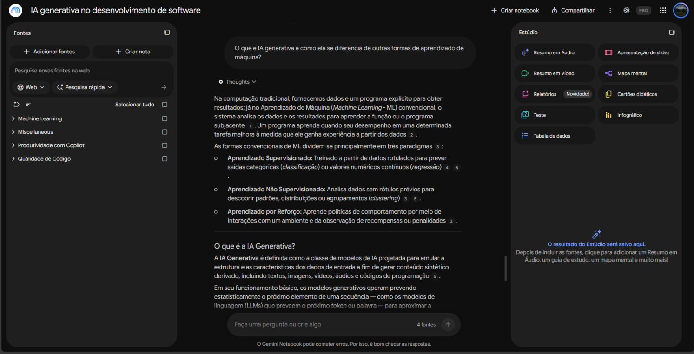

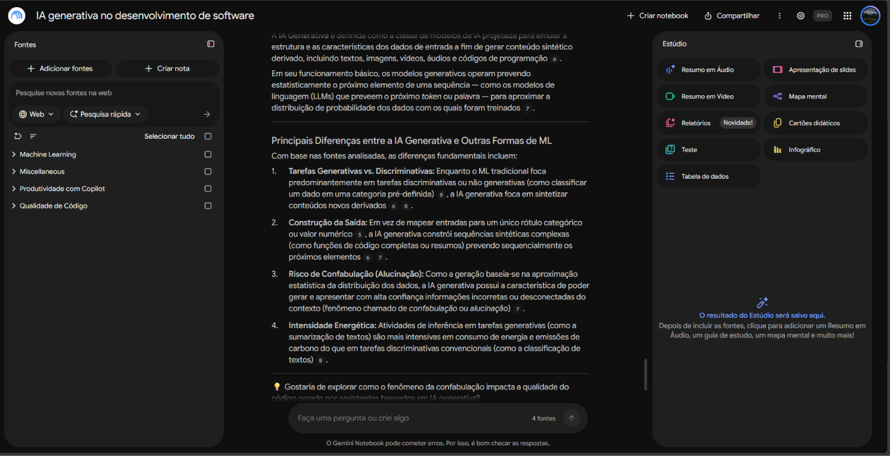

### 2. Em quais etapas do desenvolvimento de software a IA generativa pode ajudar?

**Resumo da resposta:** a IA pode apoiar a escrita e o preenchimento de código repetitivo, documentação, correções de sintaxe, pequenas reescritas, revisão de código, testes de segurança, busca técnica e resumo de artefatos. As fontes reforçam que ela oferece pontos de partida, mas o desenvolvedor continua responsável por adaptar, testar e validar o resultado.

**Fontes citadas pelo notebook:** Google for Developers, pesquisa de produtividade do GitHub e materiais selecionados sobre qualidade de código.

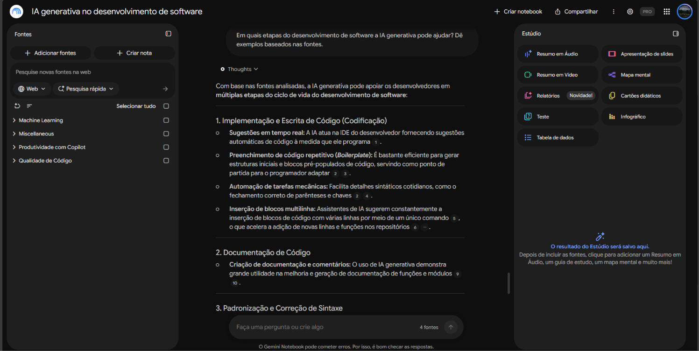

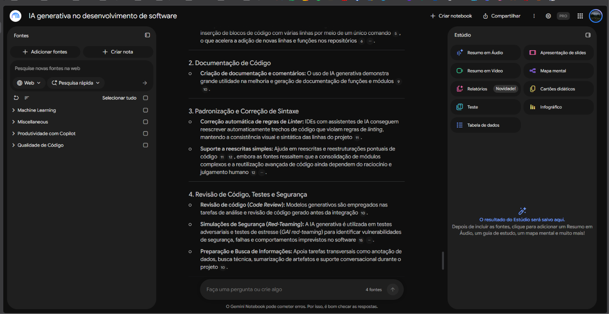

### 3. Quais evidências as fontes apresentam sobre ganhos de produtividade e quais limitações devem ser consideradas?

**Resumo da resposta:** as evidências apontam maior velocidade de escrita, aceitação de sugestões e manutenção do estado de concentração. Porém, volume de código e percepção de produtividade são métricas de curto prazo. As fontes alertam que mais código não significa necessariamente mais valor e pode vir acompanhado de duplicação, retrabalho, defeitos e custos futuros de manutenção. Testes de laboratório também podem não representar todo o ambiente real.

**Fontes citadas pelo notebook:** pesquisa de produtividade do GitHub, estudos de qualidade de código, dados mencionados do Google DORA e perfil de riscos do NIST.

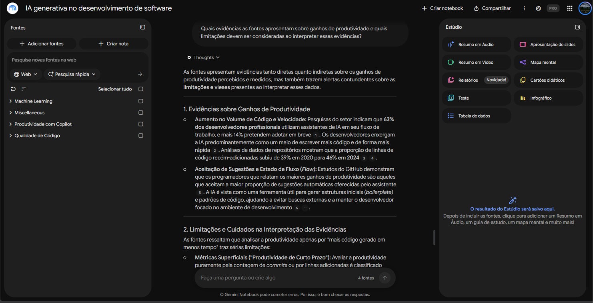

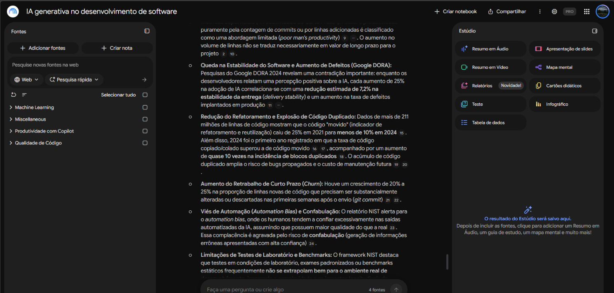

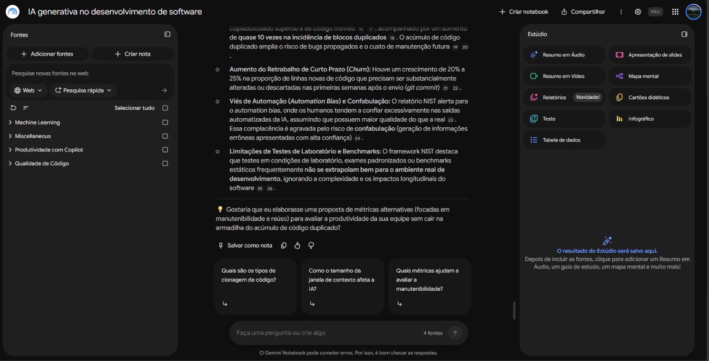

### 4. Quais riscos surgem ao usar IA generativa para produzir ou revisar código?

**Resumo da resposta:** os principais riscos são código incorreto apresentado com confiança, vulnerabilidades, dependências comprometidas, duplicação, dívida técnica, perda de manutenibilidade e confiança excessiva na automação. Como resposta, o NIST recomenda supervisão humana, testes adversariais, validação com fontes confiáveis, controle da cadeia de suprimentos e métricas que considerem qualidade e contexto.

**Fontes citadas pelo notebook:** NIST AI 600-1 e materiais selecionados sobre produtividade e qualidade de código.

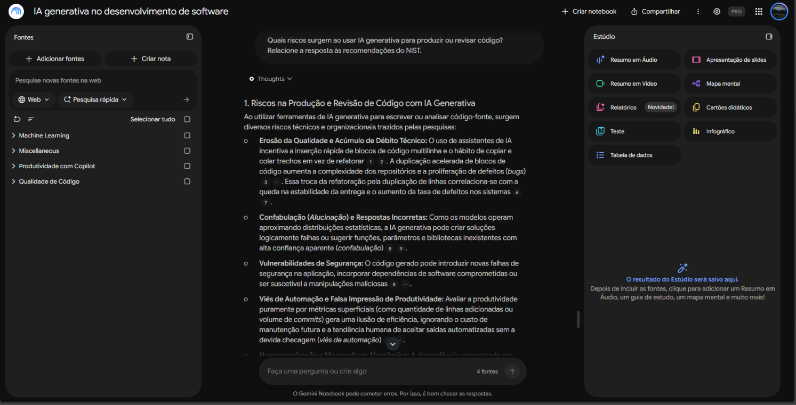

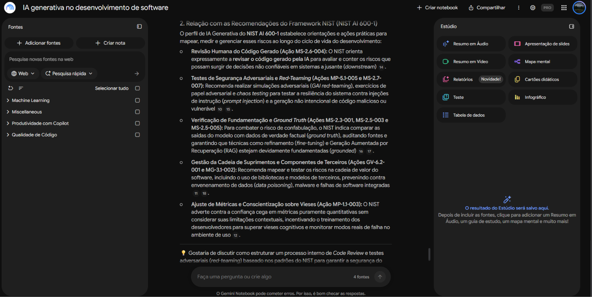

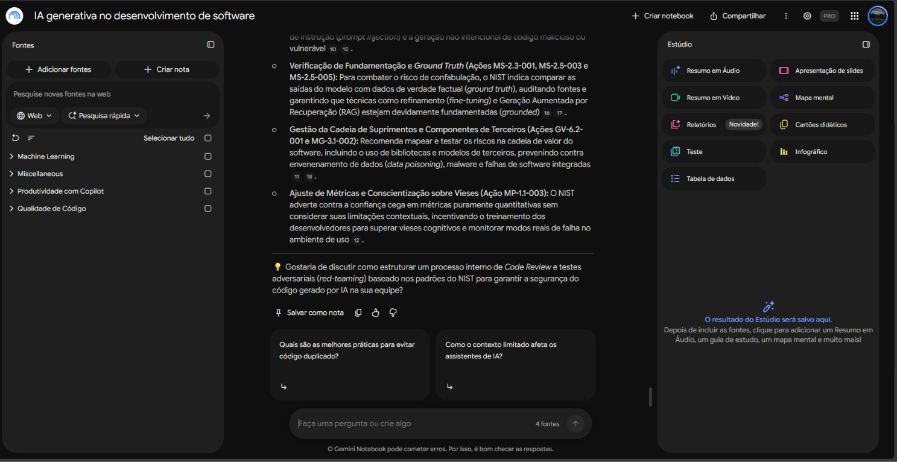

### 5. Que práticas um desenvolvedor iniciante deve seguir para usar IA generativa com responsabilidade?

**Resumo da resposta:** o desenvolvedor deve compreender e revisar todo código sugerido, evitar copiar e colar sem refatoração, proteger credenciais e dados pessoais, conferir dependências, testar vulnerabilidades, comparar respostas com documentação oficial, fornecer contexto claro e registrar mudanças em controle de versão. A IA deve ser tratada como assistente, não como responsável final.

**Fontes citadas pelo notebook:** NIST AI 600-1, GitHub e materiais selecionados sobre qualidade de código e fundamentos de IA.

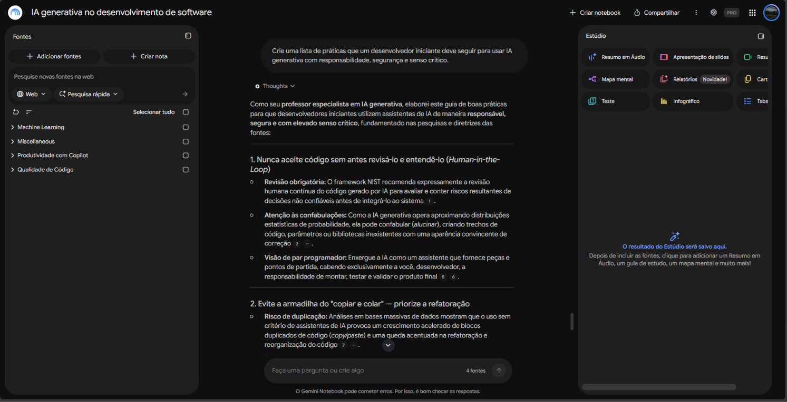

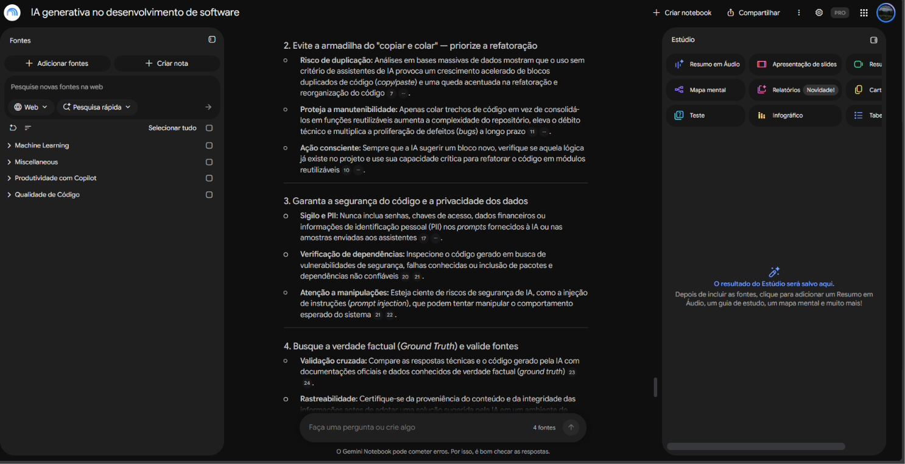

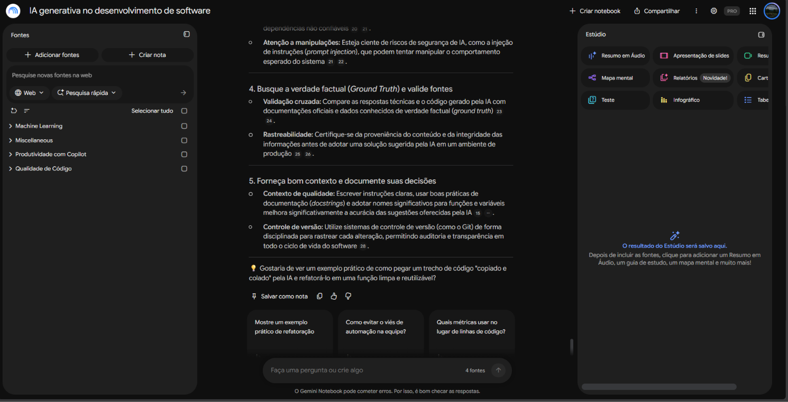

### 6. Em quais pontos as fontes concordam, se complementam ou apresentam perspectivas diferentes?

**Resumo da resposta:** as fontes concordam sobre a necessidade de supervisão humana, contexto de qualidade e validação das saídas. Elas se complementam ao cobrir fundamentos, experiência do desenvolvedor, efeitos sobre os repositórios e governança de riscos. A principal tensão está na definição de produtividade: estudos ligados a fornecedores destacam velocidade e satisfação, enquanto análises de engenharia e o NIST enfatizam estabilidade, manutenibilidade, riscos e resultados de longo prazo.

**Fontes citadas pelo notebook:** Google for Developers, GitHub, estudos selecionados sobre qualidade de código e NIST AI 600-1.

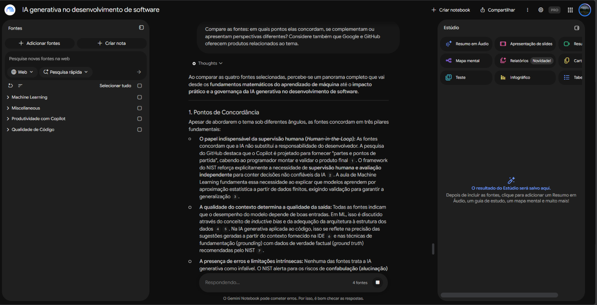

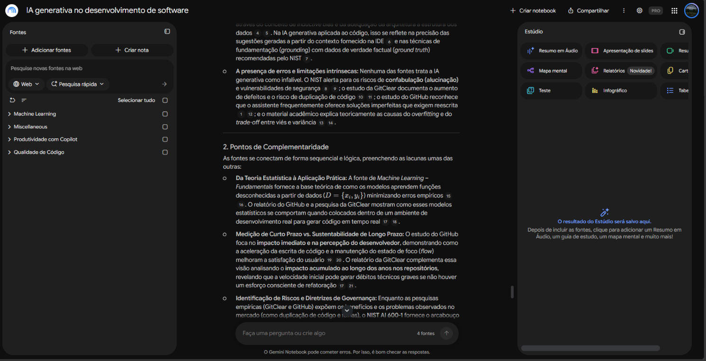

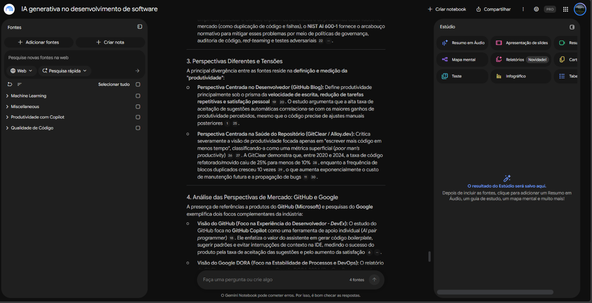

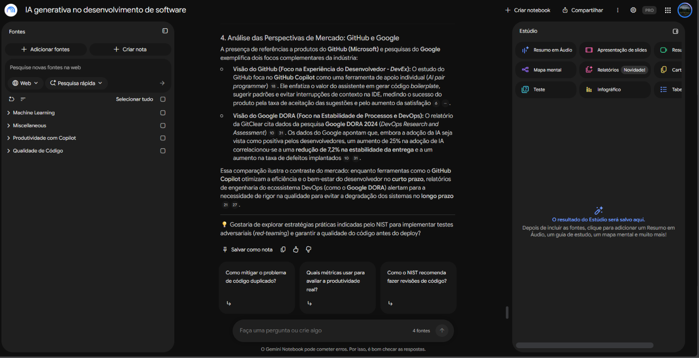

## Materiais gerados

Os seguintes materiais foram produzidos no Estúdio do Gemini Notebook:

- [Mapa mental](materiais/mapa-mental.png);
- [Apresentação em slides](materiais/slides.pdf);
- [Guia de estudos](materiais/guia-de-estudos.docx);
- [Resumo em áudio](materiais/resumo-em-audio.m4a).

## Acesso ao notebook

**Link público:** [abrir o notebook no Gemini Notebook](https://notebook.google.com/notebook/002a7bc1-0e8d-48a0-951c-c1d110444d53)

## Aprendizados

Ao comparar as fontes, ficou claro que produtividade no desenvolvimento não deve ser medida apenas pela quantidade ou pela velocidade de geração de código. A IA generativa pode reduzir trabalho repetitivo e ajudar o desenvolvedor a permanecer concentrado, mas seus benefícios dependem de revisão humana, testes, refatoração, proteção de dados e avaliação dos efeitos de longo prazo sobre a qualidade e a manutenção do software.

## Organização do repositório

```text
.
├── README.md
├── GUIA_NOTEBOOKLM.md
├── CHECKLIST_ENTREGA.md
├── evidencias/
│   ├── pergunta-01a.png
│   ├── ...
│   └── pergunta-06d.png
└── materiais/
    ├── mapa-mental.png
    ├── slides.pdf
    ├── guia-de-estudos.docx
    └── resumo-em-audio.m4a
```

## Aviso

Este projeto tem finalidade educacional. Respostas geradas por IA devem ser verificadas nas fontes originais, especialmente quando envolverem segurança, qualidade de software ou decisões profissionais.
